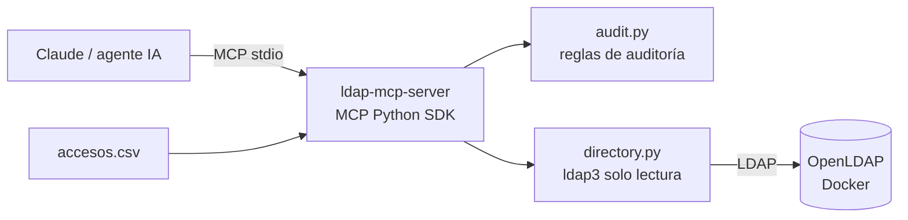

# ldap-mcp-server

Servidor **MCP (Model Context Protocol)** de solo lectura que permite a un agente de IA (Claude, u otro cliente MCP) **consultar y auditar un directorio LDAP**: buscar usuarios, ver sus grupos, detectar cuentas inactivas y cruzar listados de accesos para encontrar hallazgos de IAM.

> Proyecto demostrativo basado en mi experiencia automatizando la depuración de accesos en entornos regulados. **Todos los datos son ficticios** (`dc=example,dc=org`).

*English summary: a read-only MCP server that lets AI agents query and audit an LDAP directory (user search, group membership, inactive accounts, access-list reconciliation). Ships with a Dockerized OpenLDAP and fake data.*

## Herramientas MCP

| Herramienta | Qué hace |
|---|---|
| `buscar_usuario` | Busca por uid, nombre o correo (coincidencia parcial). |
| `listar_grupos_de_usuario` | Devuelve los grupos (`groupOfNames`) de un usuario. |
| `detectar_cuentas_inactivas` | Cuentas expiradas (`shadowExpire`) o con clave sin cambiar en más de N días (`shadowLastChange`). |
| `cruzar_accesos` | Cruza un CSV `usuario,aplicacion,rol` contra el directorio: usuarios inexistentes, cuentas expiradas y usuarios con varios roles en la misma aplicación. |

## Arquitectura



- **Solo lectura:** la conexión se abre con `read_only=True`; el servidor no expone ninguna operación de escritura.
- **Filtros LDAP escapados** para evitar inyección LDAP.
- **Lectura de CSV acotada:** `cruzar_accesos` solo lee archivos `.csv` dentro de `LDAP_MCP_CSV_DIR` (por defecto `./data`); rechaza rutas absolutas, `..`, rutas UNC y enlaces simbólicos.
- **Lógica separada del acceso a datos:** las reglas de auditoría se prueban sin servidor LDAP.

## Inicio rápido

Requisitos: Python 3.10+, [uv](https://docs.astral.sh/uv/) y Docker.

```bash
# 1. Levantar OpenLDAP con datos ficticios
docker compose up -d

# 2. Instalar dependencias y correr pruebas
uv sync
uv run pytest

# 3. Pruebas de integración contra el OpenLDAP local
cp .env.example .env
LDAP_INTEGRATION=1 uv run --env-file .env pytest
```

## Conectarlo a Claude Desktop

Agrega esto a `claude_desktop_config.json` (ajusta la ruta):

```json
{
  "mcpServers": {
    "ldap": {
      "command": "uv",
      "args": ["--directory", "C:/ruta/a/ldap-mcp-server", "run", "ldap-mcp-server"],
      "env": {
        "LDAP_URL": "ldap://localhost:389",
        "LDAP_BIND_DN": "cn=admin,dc=example,dc=org",
        "LDAP_BIND_PASSWORD": "admin_demo_local",
        "LDAP_BASE_DN": "dc=example,dc=org",
        "LDAP_MCP_CSV_DIR": "C:/ruta/a/ldap-mcp-server/data"
      }
    }
  }
}
```

Ejemplos de preguntas para el agente:

- "¿Qué cuentas llevan más de 90 días sin cambiar la clave?"
- "¿A qué grupos pertenece ana.garcia?"
- "Cruza `accesos_ejemplo.csv` contra el directorio y dime qué accesos hay que revocar."

## Estructura

```
src/ldap_mcp/
  server.py     # herramientas MCP (MCPServer, SDK oficial de Python)
  directory.py  # acceso LDAP de solo lectura (ldap3)
  audit.py      # reglas de auditoría (puras, testeables)
  models.py     # modelo Usuario
data/
  seed.ldif             # directorio ficticio
  accesos_ejemplo.csv   # listado de accesos de ejemplo
tests/                  # unitarias + integración opcional
```

## Seguridad

- Usa una cuenta de servicio con permisos **solo de lectura** sobre el directorio.
- No guardes credenciales en el repositorio: usa variables de entorno o `.env` (ignorado por git).
- Para producción usa `ldaps://` o StartTLS.

## Autor

**Kevin Stiven Naranjo González** — AI-Ops & Agentic AI Engineer · [LinkedIn](https://linkedin.com/in/kevin-stiven-naranjo-gonzalez) · [CV](https://cv-online-rust.vercel.app/)

Licencia MIT.
